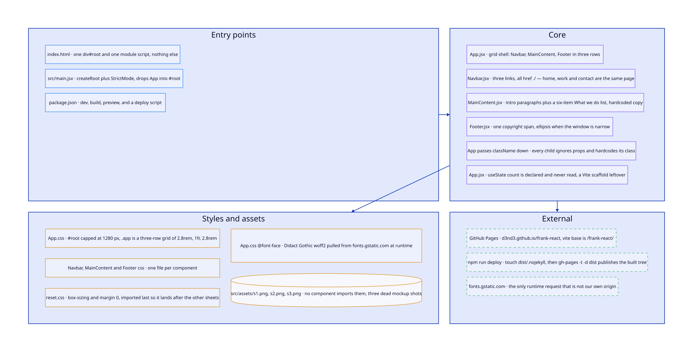

# frank-react

Frank Interior Design's site rebuilt as three React components on a CSS grid — a layout exercise, not a production site.

## Read it left to right

- **One page, no routes.** `App.jsx` is a three-row grid (2.8rem / 1fr / 2.8rem) and Navbar, MainContent and Footer only fill those rows. All three navbar links point at `./`, so home, work and contact are the same page — the nav is a layout demo.
- **The wiring is decorative.** `App` passes a `className` to each child; every child ignores props and hardcodes its own class in its own `div`. Nothing is themed through the parent.
- **CSS order is import order.** `reset.css` is imported *last* in `App.jsx`, so its `box-sizing` and `margin: 0` land after the four component sheets. `#root` caps the page at 1280 px and the shell is a grid, which is why the footer can sit at the bottom without a spacer.
- **Dark mode is half-done.** `index.css` flips the palette with `prefers-color-scheme`, but `Navbar.css` hardcodes `background-color: white` outside any media query, so the bar stays white in both.
- **`src/assets/s1.png`–`s3.png` are never imported.** Three mockup shots sit in the tree while the rendered page is text only; `npm run deploy` is the only real build step (`touch dist/.nojekyll`, then `gh-pages -t -d dist` — the `-t` is what carries the dotfile).

---

Diagram source: [`docs/system.d2`](docs/system.d2) · rendered by [`scripts/render-diagram.sh`](scripts/render-diagram.sh) into `docs/system.svg` (light + dark) and `docs/system.png` (dark, for gpm desktop).
